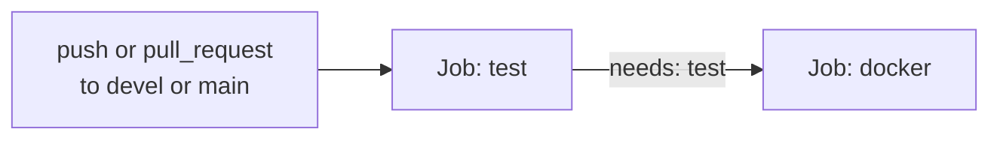

# CI/CD

See also: [Testing](Testing.md) · [Development](Development.md) · [Configuration](Configuration.md)

This repository defines a single CI pipeline: the GitHub Actions workflow below.

## GitHub Actions — `.github/workflows/ci.yml`



**Triggers** (`.github/workflows/ci.yml:3-11`): `push` and `pull_request`, both restricted to branches `devel` and `main`.

**Concurrency** (`.github/workflows/ci.yml:16-18`): grouped by `${{ github.workflow }}-${{ github.ref }}`, with `cancel-in-progress: true` — a new push to the same branch cancels an in-flight run for that branch.

**Permissions** (`.github/workflows/ci.yml:13-14`): `contents: read` only.

### Job: `test`

Runs on `ubuntu-latest`:

1. `actions/checkout@v5`.
2. `actions/setup-node@v5` with `node-version-file: '.nvmrc'` and npm caching keyed on `image/package-lock.json`.
3. `npm ci` with `working-directory: image`.
4. `npm run test:coverage` with `working-directory: image` — this is the same command documented in [Testing](Testing.md); a coverage drop below 100% fails this step.

There is no separate lint step, because no linter is configured in the repository (see [Development](Development.md)).

### Job: `docker`

`needs: test` — only runs if `test` succeeds. Steps:

1. `actions/checkout@v5`.
2. `docker build -t execution-monitor-service:${{ github.sha }} .` — builds the image from the repository root [`Dockerfile`](../Dockerfile), tagged with the commit SHA. The built image is **not pushed** anywhere by this workflow; it exists only to validate that the Dockerfile still builds successfully.

## Docker image

Defined in [`Dockerfile`](../Dockerfile) at the repository root.

```dockerfile
FROM node:24.22.1-slim
WORKDIR /app
COPY ./image /app
RUN npm ci --omit=dev
USER node
CMD ["npm", "start"]
```

- Base image is the public `node:24.22.1-slim` image.
- Only `image/` is copied into the build context; production dependencies are installed with `--omit=dev` (so `jest` is not installed in the image).
- Runs as the non-root `node` user.
- `CMD ["npm", "start"]` runs `node index.js`, i.e. `start(process.env)` — configuration must be supplied via `docker run -e VAR=value` or an orchestrator's env mechanism; nothing is baked into the image (see [Configuration](Configuration.md)).
- `.dockerignore` excludes `image/node_modules`, `image/coverage`, `image/tests`, logs, `.git`, `.gitignore`, `.nvmrc`, and all `*.md` files from the build context.

## Release / deployment

There is no release workflow (no tagging job, no npm publish, no container registry push) defined in `.github/workflows/`. Deployment/release tooling beyond this repository's CI (if any) is not part of this codebase, so its exact behavior is unknown from this codebase alone.
