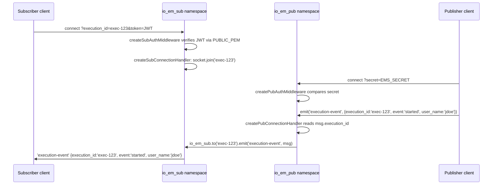

# Data Flow

See also: [Architecture](Architecture.md) · [API Reference](API-Reference.md) · [Core Components](Core-Components.md)

This page traces complete, real workflows through the implementation, from connection to message delivery.

## Workflow 1 — Subscriber connects and joins a room

```text
Client dials /api/v2/execution_event_subscribe with ?execution_id=&token=
→ createSubAuthMiddleware: token present? no  → next(Error('No authentication info was provided.')) → connection rejected
                                    → yes → jwt.verify(token, PUBLIC_PEM, {algorithms:['RS256']})
                                              → throws → log.error(...) → next(Error('Authentication error')) → rejected
                                              → ok    → log.info('jwt.verify ok') → next() → connection accepted
→ createSubConnectionHandler(log) runs for the new socket
→ handshake.query.execution_id present? → socket.join(execution_id)   [else: log.warning, no room joined]
→ socket now sits idle, listening for 'set-execution-id', 'set-procedure-id', 'disconnect'
```

Relevant code: `createSubAuthMiddleware` (`image/index.js:152-167`), `createSubConnectionHandler` (`image/index.js:172-212`).

## Workflow 2 — Publisher connects and sends an execution-event

```text
Client dials /api/v2/execution_event_publish with ?secret=
→ createPubAuthMiddleware: secret query param present?
      → no        → next() is never called → handshake does not complete (see Troubleshooting)
      → yes, mismatched → next(Error('Authentication error.')) → rejected
      → yes, matches EMS_SECRET → next() → connection accepted
→ createPubConnectionHandler(io_em_sub, log) runs for the new socket
→ log.info('io_em_pub new connection: %s', address)
→ socket listens for 'execution-event', 'procedure-event', 'disconnect'

Publisher emits 'execution-event' { execution_id, event, user_name }
→ log.debug(...) / log.trace(...)
→ execution_id truthy?
      → no  → log.warning('... execution_id was not specified.') — message dropped, nothing sent
      → yes → io_em_sub.to(execution_id).emit('execution-event', msg)
```

Relevant code: `createPubAuthMiddleware` (`image/index.js:96-106`), `createPubConnectionHandler` (`image/index.js:111-147`).

## Workflow 3 — End-to-end delivery (publish → subscribe)

This combines Workflows 1 and 2: a message only reaches a subscriber if that subscriber previously joined the matching room.



Note that room membership and message routing both use the **same string** (`execution_id`, or `` `${procedure_id}:${version}` `` for procedure events) — there is no separate mapping table; Socket.IO's own room implementation is the routing mechanism.

## Workflow 4 — Procedure-event room naming

```text
Publisher emits 'procedure-event' { procedure_id: 'proc-456', version: '1', event: 'step-completed', user_name }
→ procedure_id truthy?
      → no  → log.warning('... procedure_id was not specified.') — dropped
      → yes → room = `${procedure_id}:${version}`   // e.g. "proc-456:1"
             → io_em_sub.to(room).emit('procedure-event', msg)

Subscriber must have previously done:
  socket.emit('set-procedure-id', { procedure_id: 'proc-456', version: '1' })
which causes:
  createSubConnectionHandler → room = `${data.procedure_id}:${data.version}` → socket.join(room)
```

If `version` differs between the publisher's message and the subscriber's `set-procedure-id` call (e.g. `'1'` vs `1`, or one is `undefined`), the resulting room strings will not match and the event will not be delivered — the code does no normalization of `version`.

## Workflow 5 — HTTP health check

```text
GET /api/v2/health
→ healthHandler(req, res)
→ res.setHeader('Content-Type', 'application/json')
→ res.end('{"status":"OK","message":""}')
```

This does not check the health of Socket.IO namespaces, room state, or any dependency — it always returns the same static payload once the process is up and Express is routing requests. There is no readiness/liveness distinction in this implementation.
